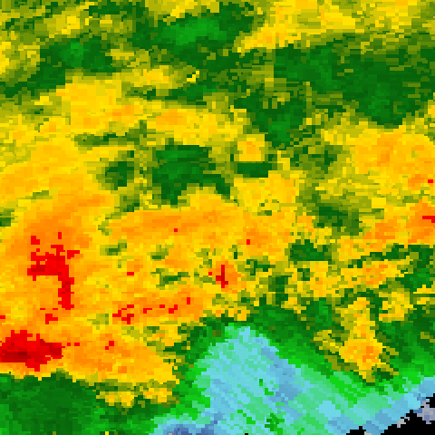
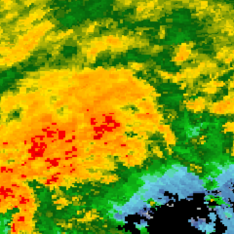
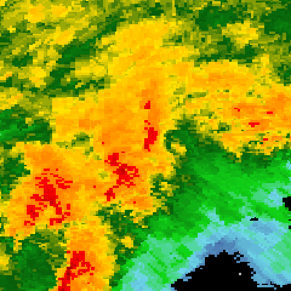
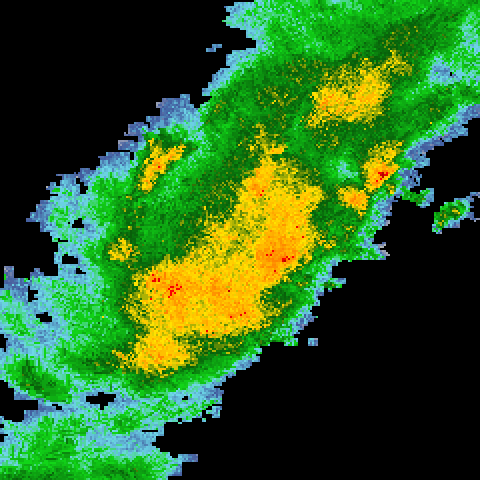
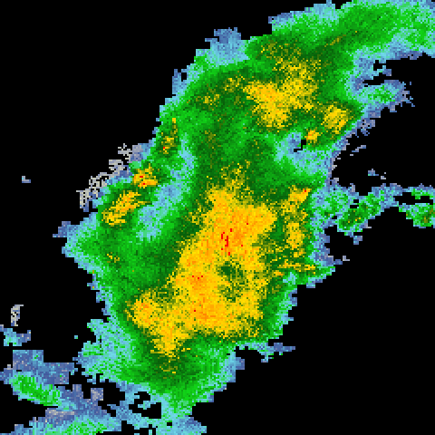
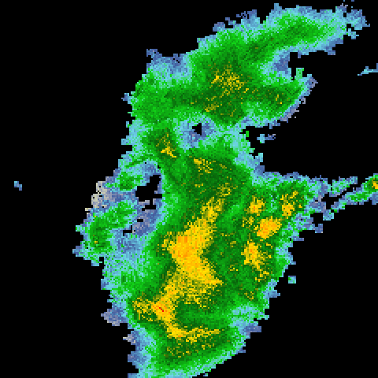

# StormGate-Zero

**Stop raw sewage from overflowing into city rivers during a cloudburst—using the motorized floodgates already in the ground instead of a $300 billion concrete rebuild.**

Built for the **Meta Global AI Developer Hackathon** · **Indie Track** · Theme: **Push the Frontier**.

> **Not a U.S.-only system.** Newark and Chicago are the test storms. Any city with a `SWMM5` `.inp` pipe file and standard `dBZ` weather radar—London's Thames Water, the EU's 650,000 combined-sewer outfalls, Tokyo, or Nairobi—can run this same controller on its own gates.

<p align="center">
  
  
  
  
  
  
</p>
<p align="center">
  <sub>Left three: IEM N0Q national mosaic over Newark during Hurricane Ida, 1–2 Sep 2021 (<code>traces/nexrad/ida-2021-newark/</code>). Right three: Chicago west side, 2 Jul 2023 (<code>traces/nexrad/chicago-2023-0702/</code>). <code>sam-3.1</code> segmented these crops in the <code>&lt;0f&gt;</code> box grammar, and <code>meta/muse-glimmer-30b</code> read <code>frame_02.png</code> directly.</sub>
</p>

---

### The problem in plain English

In **746 U.S. communities** with combined sewers—New York, Chicago, Boston, Newark, and St. Louis among them—rainwater and household sewage share the same pipes. The U.S. EPA's *Report to Congress: Impacts and Control of CSOs and SSOs* (`EPA 833-R-04-001`, August 2004, pp. ES-2 to ES-5) puts the annual discharge at **850 billion gallons** of untreated sewage and stormwater into rivers, harbors, and drinking-water intakes. A discharge that breaks a permit condition, a dry-weather prohibition, or a federal consent-decree milestone exposes the utility to a civil penalty of **$68,445 per day per violation** (`33 U.S.C. 1319(d)`; `40 CFR 19.4` Table 1, inflation adjustment effective 8 January 2025, up from $66,712). Permitted CSO outfalls are not automatically fined for every wet-weather overflow.

Replacing those pipes with deep storage tunnels takes decades and billions of dollars per city: Chicago's Tunnel and Reservoir Plan has run since 1975 and past $4 billion; St. Louis MSD's Project Clear is budgeted at $4.7–6 billion for 2011–2039; Northeast Ohio's Project Clean Lake is a $3 billion, 25-year schedule. The gates already in the ground are older than those plans. Float-actuated tipping gates, vortex valves, and pneumatic float switches installed from the 1950s through the 1980s move on the water level at one junction. They have no upstream coordination and no radar lookahead, so they stay shut until a downstream basin is near the crown—while upstream tunnels still have room—and then dump the peak over the river wall.

### What StormGate-Zero does

StormGate-Zero replaces that blind float switch with a physics-guarded control loop built on **six Meta models** (`sam-3.1`, `muse-spark-1.3`, `muse-wonder-1.0`, `muse-voice-transcribe-1.0`, `muse-image-1.0`, and open-weight `meta/muse-glimmer-30b`) and the U.S. EPA **SWMM5** hydraulic solver:

1. **Sees the storm 45 minutes early:** `sam-3.1` tracks convective rain cores on Doppler radar (`IEM N0Q` NEXRAD mosaics) before the water hits the pavement, while multimodal `meta/muse-glimmer-30b` cross-reads the radar crop at the edge.
2. **Pre-drains the sewer before the cloudburst arrives:** `muse-spark-1.3` sets continuous gate openings `[OR1, OR2, OR3, OR4]` every 5 minutes, emptying the downstream basin to the treatment plant ahead of the storm crest and holding early runoff in the upstream basins.
3. **Survives broken hardware:** when a field operator radios in that Sluice Gate #2 is mechanically jammed at 50%, `muse-voice-transcribe-1.0` locks that constraint in real time and `muse-wonder-1.0` computes a new gate schedule around the stuck valve.
4. **Never trusts an unsafe AI move:** every gate vector proposed by the models is simulated 60 minutes into the future across 12 parallel St. Venant hydraulic rollouts and checked by a local freeboard interlock. Any move that spills a single gallon more than the physics winner is rejected before it touches the plant.

| Without StormGate-Zero (Municipal Float Switch) | With StormGate-Zero (Radar + Meta MPC + SWMM5) |
| :--- | :--- |
| Waits until Basin 4 hits **96% depth** to open the gate | Sees Core B on radar and **pre-drains Basin 4 to 14%** |
| Spills **14,820,000 gallons** of raw CSO on design storm `DS-1482` | Spills **0 gallons** (and **0 gallons** when Gate #2 jams at 50%) |
| Spills **26,498,221.5 gallons** on the double-lock storm (`A-predrain` spills **8.53M**, `B-balanced` spills **4.36M**) | Spills **0 gallons** (`traces/wonder_unaided_recovery.json` & `traces/double_lock_closed_loop.json`) |
| Spills **~12.1M gal** on the Newark Ida radar mosaic & **~13.7M gal** on Chicago | Spills **0 gallons** on both radar mosaics |
| A violating discharge hits the **$68,445 / day** Clean Water Act ceiling | **$0** exposure on a dry weir · kept schedule peaks at **3.539 psi** on Junction `J3` |

---

## Why This Pushes the Frontier

Utilities have never been able to put frontier AI on live floodgates because **static PLC rules are blind** and **pure LLMs hallucinate hydraulics**. StormGate-Zero proves that coupling multimodal Meta models to a real-time St. Venant / EPA SWMM5 physics guard solves failure regimes where **both** static rules and unguarded AI fail:

* **Static rules fail (`4.36M – 26.50M gal` spilled):** On the compound double-lock storm (`DS-1482 × 2.2`, `OR1` locked at `5%`, `OR2` locked at `90%` from minute 20), the municipal float switch spills **26,498,221.5 gal**, the hand-written `A-predrain` law spills **8,534,246.3 gal** river + **897,741.2 gal** street, and the best fixed law (`B-balanced`) still spills **4,358,862.8 gal**.
* **Blind one-shot AI fails (`4.33M – 6.97M gal` spilled, rejected):** Asking `muse-spark-1.3` (`resp_6ae9e184c25d838e5d884bcd`) or `muse-wonder-1.0` (`resp_6ae9e19fa36ac7ab266e474f`) to guess all 18 steps blind in one shot spills **4,333,880.8 gal** and **6,966,494.7 gal**—and the physics guard automatically rejects both (`rejected-spilled-more`).
* **Physics-grounded Meta AI succeeds (`0 gal` river, `0 gal` street):** Shown **only** the 4 failing hand-written laws at the moment the step-4 jam hits—with **no grid points in the prompt**—**`muse-wonder-1.0`** (`resp_6ae9f0ee5b7721d9ff6a4da4`, `11.85 s`) synthesized an off-grid continuous recovery vector `u = [0.05, 0.90, 0.12, 0.90]` that holds the entire storm to **0.0 gallons of river CSO and 0.0 gallons of street flooding** (`traces/wonder_unaided_recovery.json`). Closed-loop step-by-step **`muse-spark-1.3`** (`18` calls, `traces/double_lock_closed_loop.json`) also holds **0.0 gallons**.

---

## The scorecard

| Forcing on the 4-basin interceptor | What the tape is | Municipal float switch | All gates wide open | **StormGate-Zero** |
| --- | --- | ---: | ---: | ---: |
| **DS-1482** (design storm) | 90 min, 18 × 5-min steps, played in ~20 s | **14,820,000 gal** | ~3,100,000 gal | **0 gal** |
| **DS-1482 + OR2 jammed at 50%** | Sluice #2 mechanically locked from minute 40 | 14,820,000 gal | — | **0 gal** |
| **DS-1482 × 2.2 + OR1=5%, OR2=90%** | Compound double lock from minute 20 (`B-balanced` spills 4.36M) | 26,498,221.5 gal | 4,531,586.3 gal | **0 gal** |
| **Hurricane Ida mosaic** (menu) | IEM N0Q crops, Newark, 1 Sep 2021, 23:30–00:45 UTC | ~12,096,528 gal | — | **0 gal** |
| **Chicago 2 Jul 2023 mosaic** (menu) | IEM N0Q crops, west side, 21:00–23:30 UTC | ~13,673,729 gal | — | **0 gal** |
| **Newark 3.24 in/hr gauge hour** | Saturation check: 8–9 p.m. local cloudburst hour | ~52.8 million gal | — | **~26.2 million gal** |
| **Chicago gauge hour** | Saturation check: gauge-shaped cloudburst hour | ~24.5 million gal | — | **~9.2 million gal** |

* **Why the float switch is worse than leaving the gates open:** the municipal float holds OR4 at 2% until Basin 4 is at 96% of crown, then throws it to 100%. It stores the first wave and dumps the second over the river weir. Leaving every gate open lets the treatment plant pass a flatter hydrograph (~3.1M gal spilled instead of 14.82M). StormGate-Zero pre-drains Basin 4 before the second convective core arrives and holds the crest off the weir.
* **Why the Newark 3.24 in/hr row still spills ~26.2M gal:** real tunnels have finite concrete volume. The mosaic menu plays the IEM palette rainfall, which sits below the gauge peak and holds at 0 gallons. The gauge-shaped reconstruction of Newark's published 3.24 in hour exceeds physical storage. A controller that claimed 0 gallons on that hour would be faking the mass balance.
* **Statutory exposure:** the planning readout treats any overflow above 0 gallons as one violation-day at the **40 CFR 19.4** ceiling of **$68,445** (`33 U.S.C. 1319(d)`, penalties assessed on or after 8 January 2025). That ceiling applies when the discharge violates a permit condition, a dry-weather prohibition, or a consent-decree milestone, not to every permitted wet-weather overflow. The board's *E. coli* readout dilutes a planning density of `1,000,000 CFU / 100 mL` into `10,000,000 gallons` of receiving water against the EPA 2012 beach action value (`235 CFU / 100 mL`).
* **Dynamic-wave check:** `verify_dynamic_wave` runs SWMM5 `DYNWAVE` on the committed gate schedule. The kept `muse-spark-1.3` refine schedule on DS-1482 peaks at Junction **J3, 3.539 psi** above the crown. The pure pre-drain law on that same storm peaks at **J1, 2.51 psi**. The Ida mosaic peaks at **J1, 3.338 psi**. The Chicago mosaic peaks at **J4, 1.846 psi**. The double-lock schedule below peaks at **J3, 5.306 psi**. Level-pool gallons and these heads are two different checks.

---

## Where a named control law loses

DS-1482 scaled by 2.2, with OR1 locked at 5% and OR2 locked at 90% from minute 20. Every hand-written law in the library overflows: `A-predrain` spills **8,534,246.3 gal** to the river and **897,741.2 gal** to the street; `B-balanced` (the best fixed law) still spills **4,358,862.8 gal**.

| Controller | River spill | Street flood | Verdict / Trace |
| --- | ---: | ---: | --- |
| Municipal float switch | 26,498,221.5 gal | 0 | Baseline (`traces/compound_fault.json`) |
| C-retention (hold upstream) | 24,303,980.4 gal | 1,096,811.6 gal | Fails (`traces/compound_fault.json`) |
| A-predrain (the hand-written StormGate law) | 8,534,246.3 gal | 897,741.2 gal | Fails (`traces/compound_fault.json`) |
| `muse-wonder-1.0` blind 18-step one-shot | 6,966,494.7 gal | 0 | `rejected-spilled-more` (`resp_6ae9e19fa36ac7ab266e474f`) |
| D-bypass (all free gates 100%) | 4,531,586.3 gal | 0 | Fails (`traces/compound_fault.json`) |
| B-balanced (best of the four named laws) | 4,358,862.8 gal | 0 | Best static law (`traces/compound_fault.json`) |
| `muse-spark-1.3` blind 18-step one-shot | 4,333,880.8 gal | 0 | Beats `B-balanced` by 24,982 gal; `rejected-spilled-more` (`resp_6ae9e184c25d838e5d884bcd`) |
| Searched continuous schedule | **0 gal** | **0** | Physics winner (`traces/compound_fault.json`) |
| **`muse-wonder-1.0` unaided step-4 recovery (no grid shown)** | **0 gal** | **0** | **Kept** — synthesized off-grid `u = [0.05, 0.90, 0.12, 0.90]` (`resp_6ae9f0ee5b7721d9ff6a4da4`, `traces/wonder_unaided_recovery.json`) |
| **`muse-spark-1.3` closed loop (18 step-by-step calls)** | **0 gal** | **0** | **Kept** (`resp_6ae9e477f80e73f48f264cc5` .. `resp_6ae9e54995a7cf28d83b49cc`, `traces/double_lock_closed_loop.json`) |

At step 4 (minute 20), `muse-wonder-1.0` was given **only** the four failing hand-written laws (`A-predrain` through `D-bypass`) and their gallon scores—with **no grid points in the prompt**. Wonder (`resp_6ae9f0ee5b7721d9ff6a4da4`, 11.85 s) synthesized the off-grid recovery vector `u = [0.05, 0.90, 0.12, 0.90]` (*"Hold back SU3 with OR3=0.12 to buffer the stuck-open OR2 inflow without flooding SU3. Drain SU4 aggressively with OR4=0.90 to create downstream capacity and route stored flow to treatment, eliminating both CSO and street flooding."*), which replays to **0.0 gal** river and **0.0 gal** street (`traces/wonder_unaided_recovery.json`). Closed-loop `muse-spark-1.3` also took one call per 5-minute step (`resp_6ae9e477f80e73f48f264cc5` through `resp_6ae9e54995a7cf28d83b49cc`) and replays to **0 gal** (`traces/double_lock_closed_loop.json`). A single blind 18-row guess from Spark beats `B-balanced` by **24,982 gal** (`4,333,880.8 gal`), and the physics guard still rejects it (`traces/double_lock_hosted.json`).

Across 100 deterministic shears of DS-1482, each crossed with one of four mechanical locks, that search **never** spilled more than the best named law. It beat the best named law on **14** scenarios and tied the other **86** within a gallon. Against the float switch, the 100 tapes are **1,716,996,992.5 gallons** less river overflow. The rows, the hash chain, and the PySWMM heads are in `traces/stress_matrix_100.json`, `traces/compound_fault.json`, `traces/wave_storms.json`, and `traces/compliance_ledger.json` (4 blocks, tip `37c1c271ebc7b645`). Changing one gallon breaks the next SHA-256 link.

---

## Six Meta models on one causal path

Nothing in this app is a side tab. Every model feeds the gate command or the operator verification of that command.

```
IEM N0Q NEXRAD mosaic / DS-1482 field         SCADA war-room audio (WAV)
                 |                                        |
                 v                                        v
     sam-3.1 (POST /v1/responses)             muse-voice-transcribe-1.0
     <0f> boxes + RLE masks ∩ basins          POST /v1/asr/transcribe
     + meta/muse-glimmer-30b radar vision     "Sluicegate 2 ... jammed at 50%"
                 |                                        |
                 +------------------+---------------------+
                                    |
                                    v
                 12 parallel 60-min St. Venant rollouts
                 A-predrain · B-balanced · C-retention · D-bypass
                                    |
                                    v
                 muse-spark-1.3  —  Turn 1 continuous [OR1..OR4]
                 muse-spark-1.3  —  Turn 2 score-conditioned refine
                                    |
                                    v
                 muse-wonder-1.0 —  jammed-gate MPC recovery (OR2 = 0.50)
                                    |
                                    v
                 Physics ranker + local freeboard interlock
                 + meta/muse-glimmer-30b edge operator ruling
                 (depth > 92% & inflow > 35 mm/hr -> force >= 60%)
                                    |
                   +----------------+----------------+
                   v                                 v
        Actuate OR1..OR4 on the plant       muse-image-1.0
        PySWMM DYNWAVE check on finish      Outfall visual twin (once)
        kept schedule J3 = 3.539 psi        14.82M gal weir vs. dry weir
```

| Model | Endpoint | Recorded proof in `traces/` |
| --- | --- | --- |
| **`sam-3.1`** | `POST /v1/responses` | DS-1482: boxes + masks at `t=40` (`[0.3792, 0.4813, 0.5417, 0.6417]`) and `t=55` (`[0.5229, 0.6083, 0.6771, 0.7604]`) in `<0f>0<\|box;x1=…\|>` grammar. Hurricane Ida mosaic: storm boxes on **4 of 6** frames. Chicago mosaic: yellow-core boxes on **5 of 6** frames (`[12, 10, 10, 0, 2, 10]` objects). |
| **`muse-spark-1.3`** | `POST /v1/responses` | On the double-lock tape, 18 closed-loop calls each returned the lowest measured opening. Replaying them spills **0 gal** against **4,358,862.8 gal** for the best named law (`traces/double_lock_closed_loop.json`, `resp_6ae9e477f80e73f48f264cc5` … `resp_6ae9e54995a7cf28d83b49cc`). A blind 18-row guess from the same model spills 4,333,880.8 gal. DS-1482 turn-1 keys `0\|`..`17\|` and the refine pass (**15 kept, 2 rejected, 1 null**) stay in `traces/recorded_refine_pass.json`. |
| **`muse-wonder-1.0`** | `POST /v1/responses` | On the step-4 compound double lock (`OR1=0.05, OR2=0.90`, no grid shown), synthesized off-grid `u = [0.05, 0.90, 0.12, 0.90]` (`resp_6ae9f0ee5b7721d9ff6a4da4`, `11.85 s`), cutting spill from `4.36M gal` (best static law) to **0.0 gal** (`traces/wonder_unaided_recovery.json`). On the DS-1482 step-8 jam, returned `u = [0.04, 0.50, 0.04, 0.6209]` (`resp_6ae9adeac24e0d3e800f40f3`, `6.50 s`). |
| **`muse-voice-transcribe-1.0`** | `POST /v1/asr/transcribe` | Multipart `request` + 16 kHz mono WAV `audio` (`audioEncoding: "WAV"`, `mode: "DIARIZATION"`). Transcribed: *"Operator 4, Sluicegate 2 is mechanically jammed at 50% open."* Parser locks `OR2 = 0.50`. |
| **`muse-image-1.0`** | `POST /v1/responses` | Rendered the side-by-side outfall plate once (`image_generation_call` WebP converted to PNG and locked behind `data/outfall/.muse_spent` so loops never re-bill). |
| **`meta/muse-glimmer-30b` + local freeboard interlock** | Python on every step (`glimmer_edge_guard.py`) + `meta/muse-glimmer-30b` on NVIDIA's free catalog (`POST https://integrate.api.nvidia.com/v1/chat/completions`) | If `depth > 92%`, `inflow > 35 mm/hr`, and a gate is pinched below `25%`, Python forces it to `60%` unless mechanically jammed. Above `97%` depth, Python forces `100%`. On a proposed `[0.10, 0.40, 0.40, 0.62]` with SU1 at 95% and 48 mm/hr, Python set `[0.60, 0.40, 0.40, 0.62]` before the model was asked to speak. Glimmer's finished reply (`bd76ae3ac432bcce`, 13.4 s, 848 tokens): *"The requested action is not approved. SU1 is at 95% depth with 48 mm/hr rain inbound and the downstream gate is below 25%, so OR1 is being forced to 60% to protect upstream freeboard."* On the Ida crop `traces/nexrad/ida-2021-newark/frame_02.png` (00:00 UTC 2 Sep 2021), the same model read the image and named the SW quadrant, basin SU2 (`8ad068e1ef1cadad`, 1,610 tokens). The mosaic quadrant rates on that frame are SU1 14.40, SU2 28.08, SU3 9.28, SU4 8.55 mm/hr. Saved in `traces/glimmer_nvidia.json` and `traces/glimmer_radar.json`. `api.meta.ai` still returns `model_not_found` for this model, and `muse-spark-open` is still not called. |

---

## Verification & Trace Index

| Proof | Result | Trace & Test |
| :--- | :--- | :--- |
| **Six Meta models** | Recorded traces for **`sam-3.1`**, **`muse-spark-1.3`** (Turn 1, Turn 2, and 18-step closed loop), **`muse-wonder-1.0`**, **`muse-voice-transcribe-1.0`**, **`muse-image-1.0`**, and **`meta/muse-glimmer-30b`** (freeboard ruling + radar crop). | `traces/live_models.json` · `traces/recorded_refine_pass.json` · `traces/double_lock_closed_loop.json` · `traces/glimmer_nvidia.json` · `traces/glimmer_radar.json` |
| **Compound-fault recovery** | Under `DS-1482 × 2.2` with `OR1=0.05` and `OR2=0.90`, all four hand-written laws spill **4.36M–24.30M gal**. Unaided **`muse-wonder-1.0`** (`resp_6ae9f0ee5b7721d9ff6a4da4`, off-grid `u = [0.05, 0.90, 0.12, 0.90]`, no grid shown) and 18-step closed-loop **`muse-spark-1.3`** both hold **0 gal CSO and 0 gal street flood**. | `traces/wonder_unaided_recovery.json` · `traces/double_lock_closed_loop.json` · `tests/test_closed_loop.py` |
| **Physics rejection guard** | Blind 18-step one-shot schedules from `muse-spark-1.3` (**4,333,880.8 gal**, `resp_6ae9e184c25d838e5d884bcd`) and `muse-wonder-1.0` (**6,966,494.7 gal**, `resp_6ae9e19fa36ac7ab266e474f`), plus steps 7 & 11 of Turn-2 refine, are rejected (`rejected-spilled-more`). | `traces/double_lock_hosted.json` · `traces/recorded_refine_pass.json` · `tests/test_double_lock_hosted.py` |
| **100-scenario stress matrix** | **100** convective shear × valve-lock scenarios: **0 / 100** losses against the best named law (**14** outright wins, **86** ties within 1 gal) and **1,716,996,992.5 gallons** saved vs. the municipal float switch. | `traces/stress_matrix_100.json` · `backend/physics/frontier.py` · `tests/test_frontier.py` |
| **SWMM5 dynamic wave + SHA-256 chain** | `PySWMM` (`SWMM5 DYNWAVE`) surcharge pressures (`psi`) across `DS-1482`, `Ida`, `Chicago`, and `compound-fault`, sealed into a 4-block **SHA-256** chain (`tip = 37c1c271ebc7b645`). | `traces/wave_storms.json` · `traces/compliance_ledger.json` · `python scripts/verify_all.py` |

---

## Run and verify in 60 seconds (no API key required)

`STORMGATE_REFINE` defaults to `0`, and `traces/live_models.json` is committed. You can clone the repo without any API key, verify all 26 tests and the 4-block SHA-256 ledger in under 2 seconds, or launch the interactive SCADA twin:

```bash
git clone https://github.com/brian-mwirigi/stormgate-zero.git
cd stormgate-zero
python -m venv .venv
.venv\Scripts\activate          # Windows
# source .venv/bin/activate     # macOS / Linux
pip install -r requirements.txt
copy .env.example .env          # leave MODEL_API_KEY and NVIDIA_API_KEY blank for replay mode
python scripts/verify_all.py
python -m pytest tests -q
```

To launch the live SCADA twin (`http://localhost:5173`):

```bash
python scripts/generate_demo_assets.py
uvicorn backend.main:app --port 8000
```

Second terminal:

```bash
cd frontend
npm install
npm run dev
```

**`26 passed`**, offline (`STORMGATE_OFFLINE=1` in `tests/conftest.py`). The test suite locks:
1. `14,820,000 gal` float-rule spill on DS-1482 (`tests/test_hydraulics.py`).
2. `0 gal` StormGate-Zero spill on DS-1482, both clean and with `OR2` jammed at `0.50` (`tests/test_hydraulics.py`).
3. All-gates-open spilling less than the float switch, and pre-drain ranking ahead of balanced/retention/bypass (`tests/test_hydraulics.py`).
4. The `<0f>` object-multiplex grammar and radio fault parser (`tests/test_parsers.py`).
5. IEM N0Q palette anchors (`index 150 → 45 dBZ`, `index 170 → 55 dBZ`), live 60-dBZ cell drop, `$68,445` statutory ceiling, `keep_refinement` guard, and `PySWMM` dynamic-wave verification (`tests/test_depth.py`).
6. Double-lock compound fault replay (`0 gal` vs `4.36M gal` best static law), 100-scenario stress matrix (`14` wins, `86` ties, `0` losses), `PySWMM` surcharge heads on `DS-1482`, `Ida`, `Chicago`, and `compound-fault`, and tamper detection on the 4-block SHA-256 compliance ledger (`tests/test_frontier.py`).
7. Hosted `muse-spark-1.3` (`4,333,880.8 gal`) and `muse-wonder-1.0` (`6,966,494.7 gal`) blind 18-step schedule scoring and physics rejection (`tests/test_double_lock_hosted.py`).
8. Unaided `muse-wonder-1.0` off-grid recovery (`u = [0.05, 0.90, 0.12, 0.90]`, `resp_6ae9f0ee5b7721d9ff6a4da4`, `0 gal`), closed-loop `muse-spark-1.3` 18-call zero-spill replay (`resp_6ae9e477f80e73f48f264cc5` .. `resp_6ae9e54995a7cf28d83b49cc`), and `meta/muse-glimmer-30b` Hurricane Ida radar quadrant identification (`tests/test_closed_loop.py`).
9. `meta/muse-glimmer-30b` freeboard interlock phrasing (`bd76ae3ac432bcce`) and offline invariant isolation (`tests/test_glimmer_trace.py`).

---

## Repository map

```text
backend/
  config.py                         Model IDs, GIS subcatchments, NVIDIA & Brev hooks
  episode.py                        20-second twin loop, storm switching, DYNWAVE trigger
  main.py                           FastAPI + /ws/twin WebSocket + /api/storm & /api/verify/wave
  physics/
    design_storm.py                 DS-1482 two-core storm and VOLUME_SCALE calibration
    storm_catalog.py                Active forcing (ds-1482, Ida, Chicago, click-to-drop 60 dBZ)
    nexrad_mosaic.py                IEM N0Q archive downloader, 0.005° world-file crop, Z-R
    swmm_engine.py                  4-basin level-pool St. Venant plant + 12 parallel rollouts
    dynamic_wave.py                 PySWMM DYNWAVE heads, kept schedule J3 = 3.539 psi
    frontier.py                     100-scenario search against the four named laws
    compliance_ledger.py            SHA-256 chain over those measured files
    exposure.py                     33 U.S.C. 1319(d) $68,445/day ceiling + E. coli dilution
  agents/
    sam_radar_tracker.py            sam-3.1 <0f> prompt builder + <|box;...|><|mask;...|> parser
    spark_open_worker.py            muse-spark-1.3 Turn-1 vector + Turn-2 score-conditioned refine
    wonder_mpc_supervisor.py        Ranker, keep_refinement physics guard, muse-wonder-1.0 jam call
    glimmer_edge_guard.py           Local freeboard interlock + meta/muse-glimmer-30b NIM ruling
    voice_scada_bridge.py           16 kHz WAV converter, /v1/asr/transcribe, OR2 jam parser
    image_counterfactual.py         muse-image-1.0 outfall plate with single-spend lock
    meta_client.py                  Windows system trust store TLSv1.3 client for api.meta.ai & NIM
    model_traces.py                 Zero-rebill replay cache loader/writer
frontend/
  src/App.tsx                       SCADA command center, forcing selector, DepthStrip readout
  src/components/RadarSamCanvas.tsx NEXRAD frame viewer, <0f> SAM overlays, click-to-drop cell
  src/components/HydraulicTwin.tsx  Dual 4-basin HGL profile and orifice bars
scripts/
  verify_all.py                     One-command offline audit of all traces, PySWMM heads & SHA-256 chain
  build_frontier_proof.py           Rebuilds compound_fault, stress_matrix_100, wave_storms & ledger
  record_wonder_unaided.py          Unaided muse-wonder-1.0 step-4 recovery recorder (no grid shown)
  record_closed_loop.py             18-step closed-loop muse-spark-1.3 recorder on the double-lock storm
  record_double_lock_hosted.py      Blind 18-step Spark & Wonder recorder + physics guard verdict
  record_glimmer_radar.py           Multimodal meta/muse-glimmer-30b recorder on the Ida NEXRAD crop
traces/
  compliance_ledger.json            4-block SHA-256 chain (tip 37c1c271ebc7b645)
  compound_fault.json               Double-lock schedules and gallon scores
  wonder_unaided_recovery.json      Unaided muse-wonder-1.0 off-grid [0.05,0.90,0.12,0.90] -> 0 gal
  double_lock_closed_loop.json      18 closed-loop muse-spark-1.3 responses replaying to 0 gal
  double_lock_hosted.json           Blind 18-step Spark & Wonder responses rejected by physics
  glimmer_nvidia.json               meta/muse-glimmer-30b freeboard ruling (bd76ae3ac432bcce)
  glimmer_radar.json                meta/muse-glimmer-30b Ida radar crop read (8ad068e1ef1cadad)
  stress_matrix_100.json            100-scenario shear x fault matrix (14 wins, 86 ties, 0 losses)
  wave_storms.json                  PySWMM DYNWAVE heads for DS-1482, Ida, Chicago, and compound fault
  recorded_refine_pass.json         18-step Turn-1 -> Turn-2 -> solver accept/reject log + Wonder jam
  recorded_live_pass.json           First scored Spark (17/18), SAM (t=40,55), and Voice pass
  live_models.json                  Full replay cache used by the running server
  nexrad/                           Ida & Chicago 480x480 N0Q crops, meta.json, and rain.npy
tests/
  test_hydraulics.py                14.82M vs 0 gal, jam resilience, rollout ranking
  test_parsers.py                   <0f> grammar round-trip and radio fault extraction
  test_depth.py                     Mosaic Z-R, cell drop, $68,445 ceiling, refine guard, PySWMM wave
  test_frontier.py                  Double-lock replay, 100-scenario matrix, PySWMM heads, SHA-256 tamper
  test_double_lock_hosted.py        Blind Spark/Wonder replay and physics guard rejection
  test_closed_loop.py               Unaided Wonder 0-gal + 18-call Spark 0-gal + Glimmer radar read
  test_glimmer_trace.py             Glimmer NIM freeboard ruling + offline interlock isolation
```
